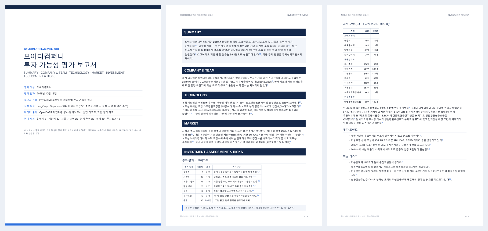
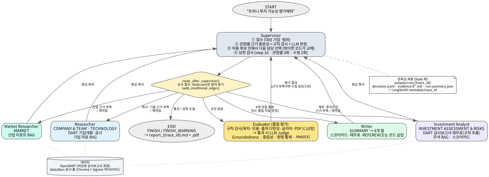

# Robotics Startup Investment Agent

**DART 감사보고서와 공개 자료로 국내 Physical AI·로보틱스 비상장 스타트업의 투자 검토 보고서를 쓰는 LangGraph Supervisor 멀티 에이전트**

> 회사 이름 하나를 넣으면, 근거를 모으고 → 충분한지 스스로 판단하고 → 부족하면 다시 조사하고 → 보고서를 쓴 뒤 → 품질 평가에 통과할 때까지 고쳐서 PDF로 내보낸다.

```bash
python main.py "브이디컴퍼니 투자 가능성 평가해줘"
```

| 결과물 | 내용 |
|---|---|
| [`examples/vdcompany/report.pdf`](examples/vdcompany/report.pdf) | 서빙로봇 기업 브이디컴퍼니 투자 검토 보고서 (A4 4쪽) |
| [`examples/twinny/report.pdf`](examples/twinny/report.pdf) | 자율주행 물류로봇 기업 트위니 투자 검토 보고서 |



---

## 왜 만들었나

비상장 스타트업은 공개 자료가 적고, 기업마다 확보할 수 있는 자료가 다르다. 정해진 순서로 도구를 돌리는 파이프라인은
자료가 없는 관점을 그대로 비워 두거나, 모델이 빈칸을 그럴듯한 문장으로 채워 버린다.

그래서 **"근거가 충분한가"를 중앙에서 판단하는 Supervisor**를 두고, 부족한 관점만 골라 담당 에이전트에게 다시 조사시키는 구조로 만들었다.
숫자처럼 틀리면 안 되는 부분은 모델이 아니라 코드가 처리한다.

## 핵심 설계

| 설계 | 하는 일 | 구현 |
|---|---|---|
| **판단과 분기의 분리** | LLM은 '근거가 충분한가'와 '허용된 후보 중 누구에게 맡길지'만 고른다. 허용 후보 계산·상한 검사·분기는 코드가 한다. 후보 밖을 고르면 코드가 교체하고 로그에 남긴다 | `supervisor.py`, `graph.route_after_supervisor()` |
| **근거 충분성 = 규칙 + LLM** | 필수 근거 종류·내용·근거 ID 연결을 규칙으로 먼저 보고, 통과한 관점만 LLM이 판정한다 | `supervisor.rule_check()` |
| **숫자는 코드가** | 감사보고서 재무제표 표에서 계정을 규칙으로 추출하고, 성장률·자본잠식·현금 소진 기간을 Python이 계산한다. 스코어카드도 LLM은 1~5점만, 가중합은 코드가 한다 | `tools/audit.py`, `agents/scorecard.py` |
| **표는 모델이 손대지 않게** | 스코어카드 표·재무 원본 표·REFERENCE는 작성 모델이 아니라 코드가 보고서에 삽입한다 | `agents/writer.finalize_markdown()` |
| **품질 평가 루프** | 규칙 검사(목차·인용·출처 다양성·판정 표현·PDF 10장 이하) → 통과 시 LLM Judge(근거성·중립성·편향 통제·커버리지). 문장 문제면 writer 수정, 근거 부족이면 수집 담당 재조사 | `agents/evaluator.py` |
| **종료 보장** | supervisor 판단 16회, 관점별 작업 3회, 수정 2회, ReAct 도구 호출 8회 상한을 코드로 강제한다. 상한에 닿으면 경고를 붙여 끝낸다 | `config.py` |
| **관측성** | 라우팅·재작업·평가 결정과 사유를 State 밖 `decisions.jsonl`에 남기고, 근거 원문은 파일로 저장한다. `trace_id` 하나로 State·로그·근거·LangSmith를 잇는다 | `observability.py` |

## Architecture



| 에이전트 | 담당 | 도구 |
|---|---|---|
| Supervisor | 접수, 근거 충분성 판정, 다음 담당 선택, 재작업·수정 지시, 종료 | - |
| Researcher | COMPANY & TEAM, TECHNOLOGY | DART 기업개황·공시, 기업 자료 RAG |
| Market Researcher | MARKET | 산업 리포트 RAG |
| Investment Analyst | INVESTMENT ASSESSMENT & RISKS, 스코어카드 | DART 감사보고서 재무표(규칙 추출)·주석 RAG, 계산기 |
| Writer | 보고서 작성 (VC 투자 검토 보고서 문체) | - |
| Evaluator | 품질 평가 (규칙 + LLM Judge) | - |

하위 에이전트끼리는 엣지가 없다. 모든 통신은 Supervisor를 거치고, 실행 순서는 코드에 없다.
실제 실행 예 (브이디컴퍼니): `researcher ×3 (기술 근거 재작업) → market_researcher ×3 → investment_analyst ×3 → writer → evaluator(통과) → FINISH`

## 평가 체계

보고서 목차: `SUMMARY` → `COMPANY & TEAM` → `TECHNOLOGY` → `MARKET` → `INVESTMENT ASSESSMENT & RISKS` → `REFERENCE`

| 스코어카드 항목 | 창업자 | 시장성 | 제품·기술력 | 경쟁 우위 | 실적 | 투자조건 |
|---|:---:|:---:|:---:|:---:|:---:|:---:|
| 가중치 | 5 | 30 | 25 | 20 | 10 | 10 |

근거가 없는 항목은 결측으로 남기고 분모에서 뺀다. 점수는 평가 보조 지표이며, 보고서는 투자를 권하거나 말리지 않는다.

## Results

| 기업 | 분야 | 2025 매출 | 2025 영업손익 | 종합 점수 | 실행 경로 |
|---|---|---:|---:|:---:|---|
| 브이디컴퍼니 | 서빙로봇·외식업 자동화 | 124억원 | 영업손실 42억원 | 59.0 | 기술 근거 재작업 2회, 시장·투자 근거 각 재작업 2회 → 품질 평가 1회 통과 |
| 트위니 | 자율주행 물류·제조 로봇 | 49억원 (연결) | 영업손실 67억원 | 66.2 | 시장 근거 재작업 2회 → 품질 평가 1회 통과 |

두 기업 모두 실제 OpenDART 감사보고서와 공개 자료로 실행한 결과다. 같은 코드라도 기업마다 자료 상황이 달라 Supervisor의 재작업 경로가 달라진다.

## Tech Stack

- **Orchestration**: LangGraph (Supervisor + ReAct 서브그래프, `add_conditional_edges`, InMemorySaver)
- **LLM**: OpenAI `gpt-5-mini` (생성·Judge 모델 분리 가능), structured output
- **Retrieval**: ChromaDB + 한국어 bigram 키워드 재정렬 하이브리드 검색, OpenAI `text-embedding-3-small`
- **Data**: OpenDART API (비상장 기업 포함 기업개황·공시·감사보고서 원문), `data/docs` 문서 풀
- **Report**: Markdown → PDF (PyMuPDF): 표지, 각주형 인용, 한글 어절 단위 줄바꿈, 쪽 나눔 제어
- **Observability**: LangSmith, 로컬 결정 로그(`decisions.jsonl`)
- **Test**: pytest (가짜 LLM으로 라우팅·재작업·평가 루프·종료·스코어카드·파서 검증, API 키 불필요)

## Quick Start

```bash
python -m venv .venv && source .venv/bin/activate
pip install -r requirements.txt
cp .env.example .env          # OPENAI_API_KEY, OPENDART_API_KEY (LangSmith는 선택)

pytest -q                                  # API 키 없이 9개 테스트
python main.py "트위니 투자 가능성 평가해줘"   # 실제 실행
python scripts/eval_retrieval.py           # 검색 품질 (Hit Rate@5, MRR)
```

새 기업을 평가하려면 `data/docs/companies/<DART 회사명>/`에 그 기업의 공개 자료(PDF 또는 출처가 적힌 수집 메모)를 넣는다.
자료가 없으면 해당 관점은 결측·한계로 표시된다.

| 출력 | 내용 |
|---|---|
| `outputs/reports/report_{trace_id}.pdf` | 최종 보고서 (제출용 PDF) |
| `outputs/runs/{trace_id}/decisions.jsonl` | Supervisor 라우팅·재작업·평가 결정과 사유 |
| `outputs/runs/{trace_id}/run-summary.json` | 라우팅 순서, 재작업 횟수, 최종 상태 |
| `outputs/runs/{trace_id}/evidence/E*.md` | 근거 원문 |

## Directory

```
├── invest_agent/
│   ├── graph.py            # Supervisor 그래프 (add_conditional_edges)
│   ├── supervisor.py       # 접수·충분성 판정·라우팅·재작업·종료
│   ├── state.py            # State Schema (제어 메타 / 페이로드 분리, reducer)
│   ├── config.py           # 상한·관점·스코어카드 가중치
│   ├── agents/             # workers(3종), scorecard, writer, evaluator
│   ├── prompts/            # 에이전트별 프롬프트
│   ├── tools/              # OpenDART, 감사보고서 파서, 문서 풀 RAG, 도구 정의
│   ├── observability.py    # trace_id, 결정 로그, 근거 파일
│   └── pdf_export.py       # 보고서 PDF
├── data/docs/              # 문서 풀 (industry/, companies/<회사명>/)
├── examples/               # 실제 실행 결과 (보고서 PDF·md, 결정 로그)
├── scripts/eval_retrieval.py
├── tests/
├── backend/app.py          # FastAPI SSE API (선택)
└── main.py                 # CLI
```

## Limitations & Next Steps

- 문서 풀의 웹 자료는 공개 기사·자료를 원문 수치 그대로 요약한 수집 메모다. 원문 PDF를 넣으면 페이지 단위로 직접 검색한다.
- 공개 자료가 적은 비상장사 특성상 창업자·기술 검증 항목은 결측이 잦다. 특허·정부 R&D 데이터 연동이 다음 과제다.
- 기업 여러 곳을 한 번에 비교하는 모드, 웹 검색 도구 연동은 범위에서 뺐다.

## Background

SKALA 4기 *AI Agent 설계 및 구축* 과목의 Multi-Agent Orchestration 과제(Supervisor 패턴)에서 출발했다.
과제 당시 팀 레포의 재무 분석 에이전트(OpenDART 클라이언트·사업보고서 RAG)를 기반으로, Supervisor 재설계·State Schema·품질 평가 루프·
감사보고서 파서·스코어카드·문서 풀 RAG·보고서 PDF를 새로 구현하고 주제를 로보틱스 스타트업 투자 평가로 바꿨다.

> 이 저장소의 보고서는 공개 자료 기반의 평가 참고 자료이며 투자 권유가 아니다.
